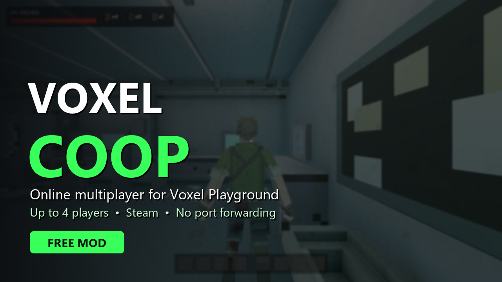
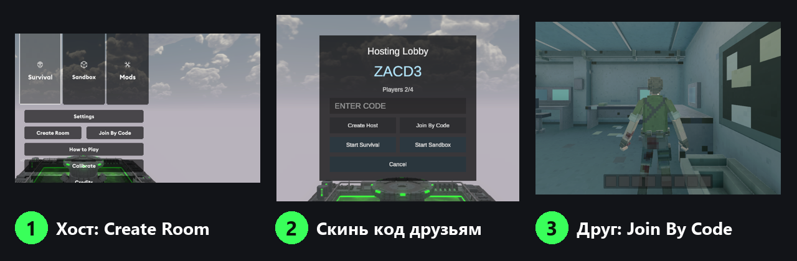

# VoxelCoop: online co-op for Voxel Playground

**[English](#english) · [Русский](#русский)**

---

## English

Voxel Playground already contains an unfinished 4-player co-op mode made by the developers. It is hidden and only works on a local network.
**VoxelCoop** turns it on and makes it work over the internet through Steam. You don't need port forwarding, a VPN or a dedicated server.

### Features
- Shows the hidden **Create Room** / **Join By Code** buttons in the main menu.
- Rooms are reachable over the internet. The 5-letter room code is published as a Steam lobby, and game traffic goes through Steam's relay network (Steam P2P).
- Up to 4 players. The game itself syncs players, hands, weapons, voxel destruction and NPCs. VoxelCoop only carries the traffic.
- Optional direct connection by IP (Radmin VPN / Hamachi / port forwarding).
- If a game update breaks part of the mod, the rest keeps working, and the log says what failed.

### Requirements
- Voxel Playground (Steam), the current version.
- **Every player** needs the mod.
- Steam must be running.

### Install
1. Download `VoxelCoop-1.0.0.zip` from [Releases](../../releases/latest).
2. In Steam, right-click Voxel Playground → **Manage → Browse local files**.
3. Extract **everything** from the zip into that folder, next to `Voxel Playground.exe`.
4. Start the game. **The first start takes 1–3 minutes**: the BepInEx loader prepares its files and needs internet access. Later starts are normal.

The zip already contains [BepInEx 6](https://github.com/BepInEx/BepInEx) (IL2CPP build #791), which the mod needs.

### Play
- **Host:** main menu → **Create Room** and send the code to your friends. The top-left corner shows *"Room XXXXX is open to friends over the internet (Steam)"*.
- **Friends:** main menu → **Join By Code** → enter the code.
- When everyone is in, the host presses **Start Sandbox** (pick a map → Play) or **Start Survival**.

### Troubleshooting
- Check that `BepInEx\LogOutput.log` contains `VoxelCoop 1.0.0 loaded`. If it doesn't, BepInEx did not start (antivirus? the files are not next to the exe?).
- If the first start hangs, BepInEx can't reach `unity.bepinex.dev` to download Unity libraries. Run the first start with a VPN.
- *"Room not found on Steam"*: check the code. The host must stay in the room.
- *"Host has a different VoxelCoop version"*: everyone should install the same version.
- Direct IP instead of Steam: on the joining side, set `ExtraHosts = <host IP>` in `BepInEx\config\com.pc.voxelcoop.cfg`.
- Report bugs with **both** players' `BepInEx\LogOutput.log` (the `[tunnel]` lines matter most).

### Uninstall
Delete `winhttp.dll` from the game folder; this disables everything. To remove the mod completely, also delete `BepInEx\`, `dotnet\`, `doorstop_config.ini`, `.doorstop_version` and `changelog.txt`.

### Known limits
- **Beta.** The Steam tunnel was tested on one PC (two game instances). Joins between two different Steam accounts over the internet need more real-world testing, so please report how it works for you.
- The co-op mode is the developers' unreleased code, so expect bugs in it. A game update can also break the mod.
- Tested in flatscreen mode. VR co-op should work the same way but has not been tested yet.
- Some antivirus programs flag `winhttp.dll` (the BepInEx loader). This is a known false positive.

---

## Русский

В Voxel Playground уже есть недоделанный разработчиками кооп на 4 игрока. Он спрятан и работает только в локальной сети.
**VoxelCoop** включает его и пускает через интернет по Steam. Не нужны ни проброс портов, ни VPN, ни сервер.

### Что умеет
- Показывает в главном меню спрятанные кнопки **Create Room** / **Join By Code**.
- Комната доступна по интернету: 5-значный код публикуется как Steam-лобби, а трафик игры идёт через ретрансляторы Steam (Steam P2P).
- До 4 игроков. Игроков, руки, оружие, разрушение вокселей и NPC синхронизирует сама игра, мод только передаёт трафик.
- Запасной вход напрямую по IP (Radmin VPN / Hamachi / проброс портов).
- Если обновление игры что-то сломает, остальная часть мода продолжит работать, а в логе будет написано, что сломалось.

### Установка
1. Скачай `VoxelCoop-1.0.0.zip` в [Releases](../../releases/latest).
2. Steam: ПКМ по Voxel Playground → **Управление → Просмотреть локальные файлы**.
3. Распакуй **всё** из архива в эту папку, рядом с `Voxel Playground.exe`.
4. Запусти игру. **Первый запуск идёт 1–3 минуты**: загрузчик BepInEx готовит файлы, и ему нужен интернет. Дальше игра запускается как обычно.

Мод нужен **у всех игроков**, Steam должен быть запущен.

### Как играть
- **Хост**: главное меню → **Create Room**, скидывает код друзьям. Слева сверху появится *«Комната XXXXX открыта для друзей по интернету (Steam)»*.
- **Друзья**: главное меню → **Join By Code** → вводят код.
- Когда все зашли, хост жмёт **Start Sandbox** (карта → Play) или **Start Survival**.

### Если не работает
- В `BepInEx\LogOutput.log` должна быть строка `VoxelCoop 1.0.0 loaded`. Если её нет, BepInEx не запустился: проверь антивирус и что файлы лежат рядом с exe.
- Первый запуск висит: BepInEx не может скачать библиотеки Unity с `unity.bepinex.dev`. Сделай первый запуск с VPN.
- «Комната не найдена в Steam»: проверь код. Хост должен оставаться в комнате.
- «У хоста другая версия VoxelCoop»: поставьте всем одну версию.
- Вход напрямую по IP: у того, кто заходит, впиши в `BepInEx\config\com.pc.voxelcoop.cfg` строку `ExtraHosts = <IP хоста>`.
- О багах пиши с файлами `BepInEx\LogOutput.log` **обоих** игроков (главное в них — строки `[tunnel]`).

### Ограничения
- **Бета.** Туннель через Steam проверен на одном ПК (два окна игры). Вход между двумя разными Steam-аккаунтами по интернету ещё мало проверен вживую, так что отпишитесь, как у вас.
- Кооп-режим недоделан разработчиками, баги возможны. Обновление игры может сломать мод.
- Проверено в обычном режиме, VR пока не тестировался.

### Удаление
Удали `winhttp.dll`, и всё отключится. Полностью: ещё `BepInEx\`, `dotnet\`, `doorstop_config.ini`, `.doorstop_version` и `changelog.txt`.

---

## For developers

The mod has two main parts:
- `src/Tunnel.cs`: the game keeps its LAN protocol (UDP discovery on 7771 + FishNet on 7770). Its packets are wrapped in Steam `ISteamNetworkingMessages` messages, so the joining game sees the host at `127.0.0.1`.
- `src/Plugin.cs`: two Harmony patches, `LanUdpDiscoveryService.BuildBroadcastEndpoints` (adds the tunnel endpoint) and `FishNetLanSessionCoordinator.JoinLanByCode` (starts the Steam lookup).

Build: run `sh build.sh` with `GAME_DIR` (the game with BepInEx, started once) and `CSC` (path to Roslyn `csc.dll`).
Dev testing on one PC: `tools/coop2.ps1` starts two flatscreen instances with `-vcoopdev -vcoopudp`, which replaces Steam with a local UDP carrier.

## Credits
- [BepInEx](https://github.com/BepInEx/BepInEx), [HarmonyX](https://github.com/BepInEx/HarmonyX), [Il2CppInterop](https://github.com/BepInEx/Il2CppInterop). See [THIRD_PARTY.md](THIRD_PARTY.md).
- The co-op itself was made by the Voxel Playground developers (Cydream). VoxelCoop only enables it and tunnels it.
- This mod was written with the help of an AI coding assistant (Claude Code, Claude Opus 5.5).
- Not affiliated with the game's developers or with Valve.

## License
MIT. See [LICENSE](LICENSE).
